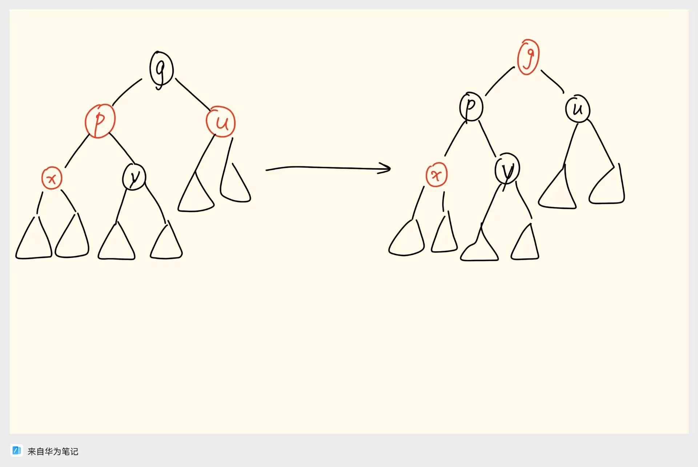
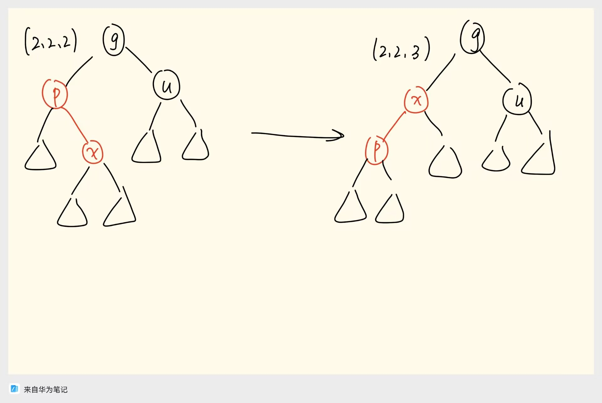
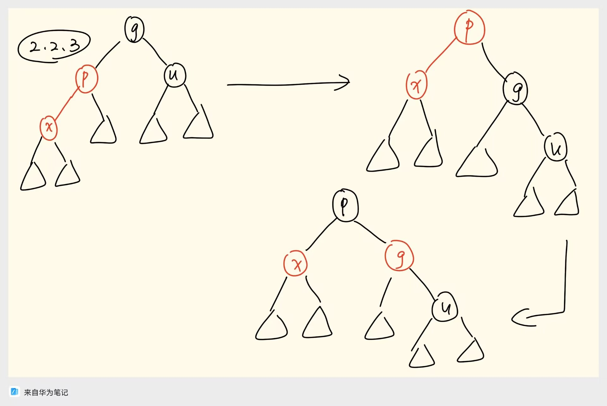
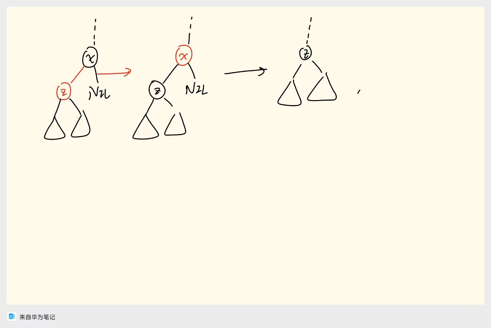
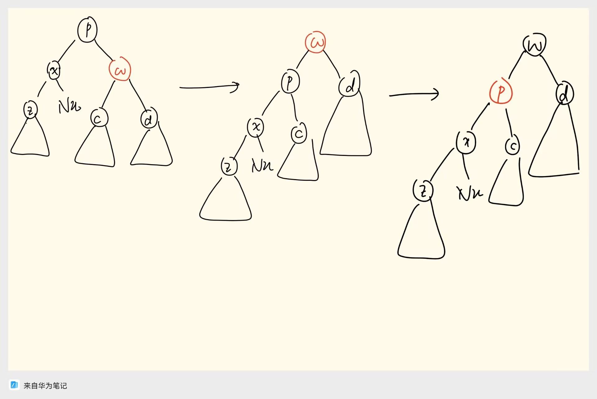
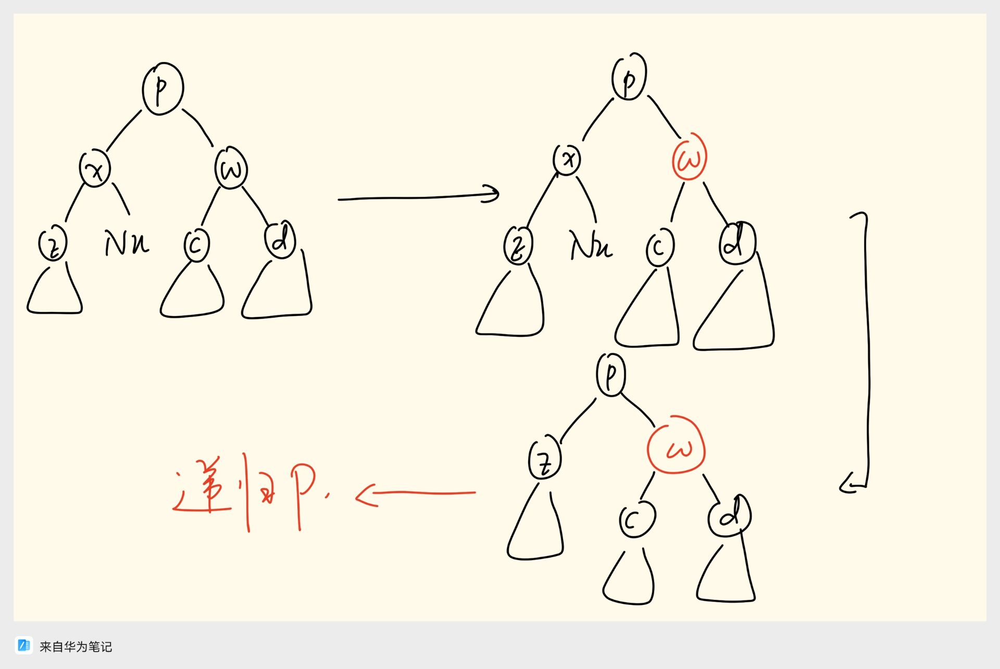
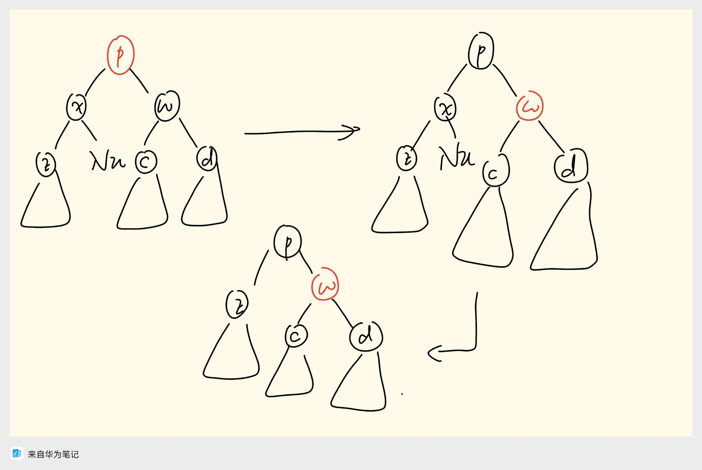
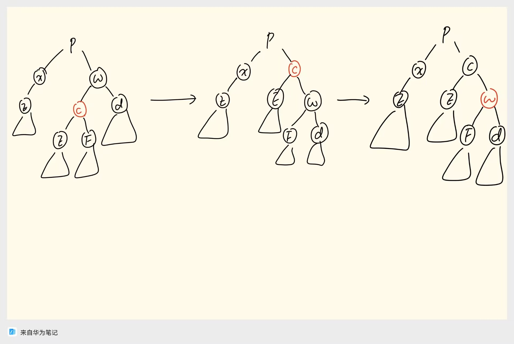
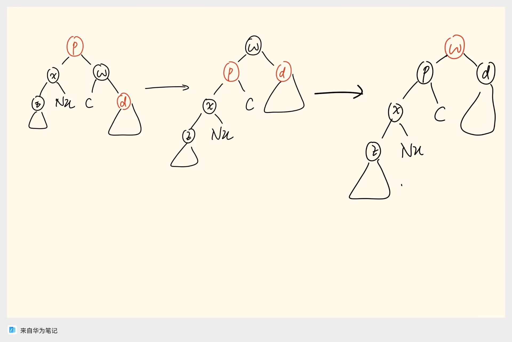
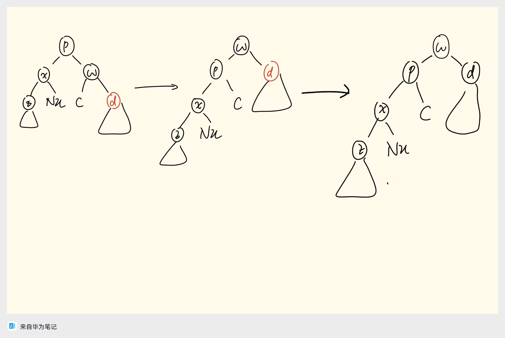

红黑树的插入操作为执行以下流程：

$1.$ 根据二叉搜索树的性质，找到插入的元素应在的位置，创建新节点 $x$，将 $x$ 的颜色设为红色。

$2.$ 如果 $x$ 没有父亲节点，代表 $x$ 为树根，将 $x$ 变为黑色，插入完成。否则，判断父亲节点 $p$ 的颜色：

$2.1.$ 如果 $p$ 为黑色，则插入完成。

$2.2.$ 如果 $p$ 为红色：此时发生了双红碰撞。由于 $p$ 为红色，兄弟 $y$ 一定为黑色，且 $p$ 不为根，一定存在 $p$ 的黑色父亲 $g$ 和兄弟 $u$。讨论 $u$ 的颜色：

$2.2.1.$ 如果 $u$ 为红色，则反转 $p,u,g$ 的颜色。由于 $g$ 变成红色，可能又发生了双红碰撞，那就递归上去处理，就好像在插入 $g$ 一样。

$2.2.2.$ 如果 $u$ 为黑色，且 $g,p,x$ 呈之字形，则对 $p$ 旋转化为 $2.2.3$。

$2.2.3.$ 如果 $u$ 为黑色，且 $g,p,x$ 呈一字型，则对 $g$ 旋转，把 $p$ 转上来，再交换 $p,g$ 颜色。

可以看到，只有情况 $2.2.2$ 和 $2.2.3$ 可能发生旋转，而 $2.2.2$ 通过旋转转化为了 $2.2.3$。而 $2.2.1$ 的递归不需要旋转，因此整个插入过程最多 $2$ 次旋转。

对于删除操作，流程如下：

$1.$找到要删除的节点 $x$。

$2.$如果 $x$ 有两个内部儿子，则找到 $x$ 右子树中元素最小的节点 $y$，交换 $x,y$，转化为删除换下来的 $x$。这样 $x$ 只能有最多一个内部儿子。

$3.$我们希望用 $x$ 现在那个唯一的内部儿子 $z$ 替换 $x$（如果 $x$ 两个儿子都是外部儿子，那就用外部儿子替换 $x$）。现在讨论 $x$ 的颜色：

$3.1.$如果 $x$ 为红色，则 $z$ 一定是黑色，直接把 $z$ 替换上来，删除操作完成。

$3.2.$如果 $x$ 为黑色，讨论 $z$ 的颜色：

$3.2.1.$如果 $z$ 为红色，直接交换 $x,z$ 的颜色，转换为 $3.1$。

$3.2.2.$如果 $z$ 为黑色，则把 $z$ 替换上来会导致 $z$ 这颗子树的黑高减少 $1$。考察 $x$ 的父亲 $p$ 和兄弟 $w$，以及 $w$ 的两个儿子 $c,d$。（如果 $x$ 是根，则可以直接用 $z$ 替换 $x$，删除结束）

$3.2.2.1.$如果 $w$ 是红色，则 $p,c,d$ 为黑色，则旋转 $p$ 并交换 $p,w$ 的颜色，转化为 $x$ 的兄弟是黑色的情形。

$3.2.2.2.$如果 $w$ 是黑色，讨论 $c,d$ 的颜色：

$3.2.2.2.1.$如果 $c,d$ 均为黑色，讨论 $p$ 的颜色：

$3.2.2.2.1.1.$如果 $p$ 是黑色，则将 $w$ 变为红色。这样把 $z$ 替换上来之后，$p$ 这棵子树的黑高整体减少 $1$，这和 $3.2.2$ 描述的问题是一样的，于是可以向上递归处理，最后用 $z$ 替换 $x$。（如果 $p$ 是根就可以结束了）

$3.2.2.2.1.2.$如果 $p$ 是红色，则交换 $p,w$ 颜色，用 $z$ 替换 $x$，完成。

$3.2.2.2.2.$不妨设 $p,w,d$ 呈一字型，$p,w,c$ 呈之字形。如果 $c$ 红而 $d$ 黑，可以旋转 $w$ 并交换 $w,c$ 颜色，转化为 $3.2.2.2.3$。

$3.2.2.2.3.$如果 $d$ 是红色，讨论 $p$ 的颜色：

$3.2.2.2.3.1.$如果 $p$ 是红色，则把 $w$ 转上来，然后将 $w$ 变为红色，$p,d$ 变为黑色。

$3.2.2.2.3.2.$如果 $p$ 是黑色，则把 $w$ 转上来，然后将 $d$ 变为黑色。

综上所述，只有 $3.2.2.1$，$3.2.2.2.2$ 和 $3.2.2.2.3$ 需要旋转。$3.2.2.1$ 的旋转将情形转化为 $3.2.2.2$，而 $3.2.2.2.2$ 的旋转又将情形转化为 $3.2.2.2.3$，于是最多只会产生 $3$ 次旋转。
