# 学一
#### 早餐
#### 正餐
涮羊肉 大份20元 评分8.5/10

我加的是麻酱，羊肉分量非常够，吃起来很过瘾

不过热量高当然是真的，过瘾是过瘾了，就是要胖了qwq

粉丝量有点不够，要是换一些青菜变成粉丝就更好了

吃的居然有点饱，可能和当天状态有关qwq

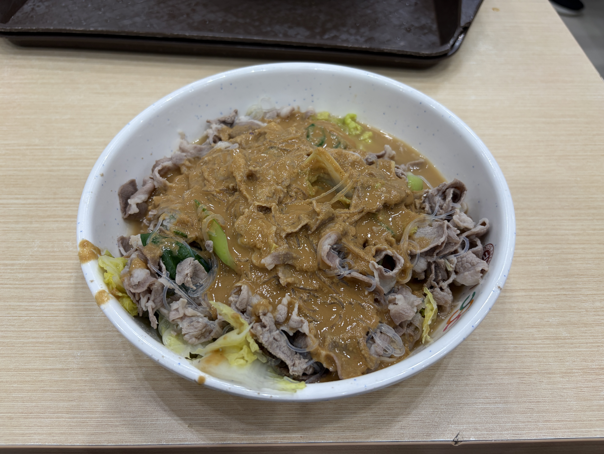
{width=400}

# 学五
#### 早餐
#### 正餐
黑椒肥牛滑蛋饭 18元 评分6/10

洋葱加的实在是太多了，以至于黑椒和洋葱冲击般的味道占据了绝对上风

牛肉品质一般般，有一些嚼不动的筋啥的

滑蛋也不像一般的滑蛋。总之问题就在香味被黑椒和洋葱掩盖了。

分量还是不错的

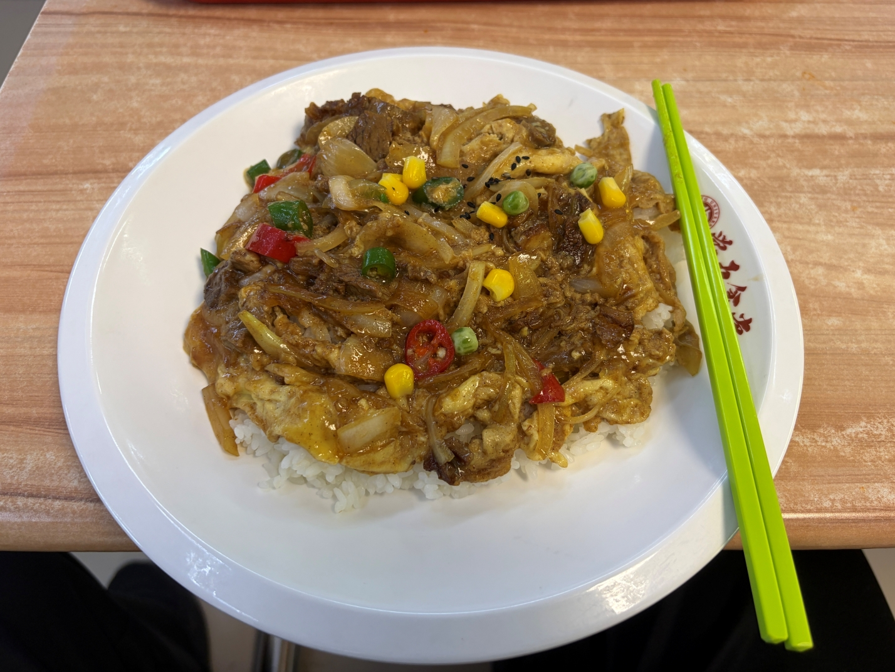
{width=400}

黄金鸡柳饭 5.5/10

鸡柳软绵绵，没啥味道，这顿只能说能饱腹，好像回到了小学那超级难吃的饭堂。。

好吧其实是我蔬菜选错了，冬瓜盖在饭上让饭变得湿漉漉的，体验进一步下降

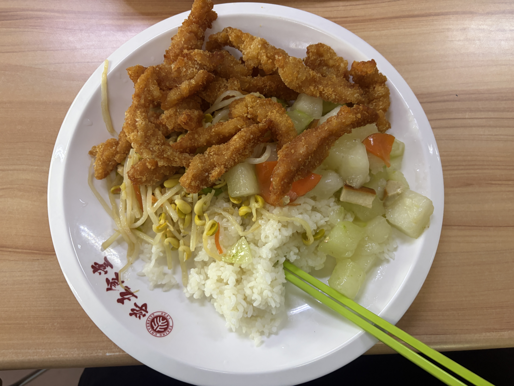

# 家一
#### 早餐
韭菜饺 评分3/10

没肉吗？这咋吃

皮还是硬的，根本没加热透

拉完了

虾饺 评分 5/10

像在嚼大团有韧性的面团，总而言之虾太少了，面皮太厚了

煎堆 评分7/10

个头加大版的煎堆，比较油腻

普普通通，也没什么槽点

# 家二
#### 正餐
烤五花肉拌饭 16元 7.5/10 日韩窗口

五花肉味道不错，还有紫菜丰富口感

但是我很讨厌泡菜，以及里面加的一些黄色姜块。

要是换点别的配料就完美了

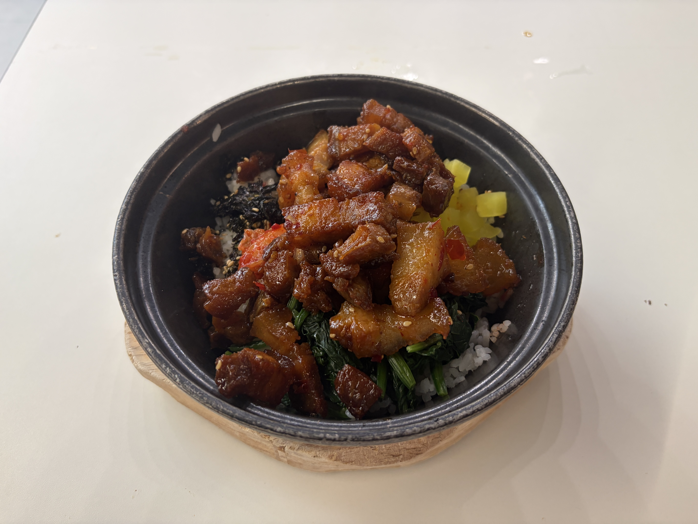
{width=400}

重庆牛肉小面 16元 9/10 面食窗口

感觉回到了成都的那个难忘的小面馆！当然辣度完全比不上，但对于广东人的我来说刚刚好XD

牛肉的质量其实有点不稳定，根据我吃这道菜的多次经验...但是总体来讲还是很好的，给我留下了很不错的印象

分量对我刚刚好

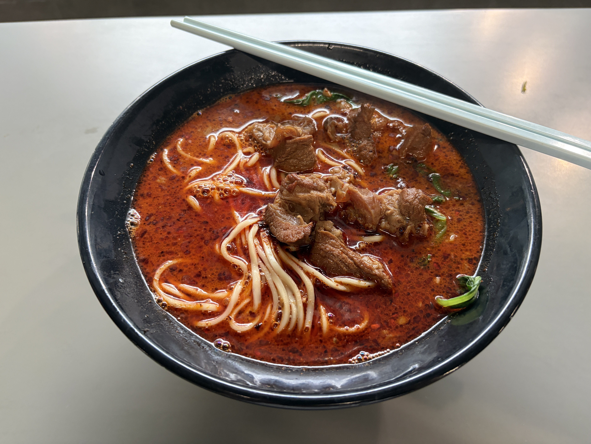
{width=400}

重庆排骨小面 16元 8.5/10 面食窗口

肉比牛肉面少一点，不过胜在没有那种嚼不断的筋啥的，可能这就是排骨的独有优点！

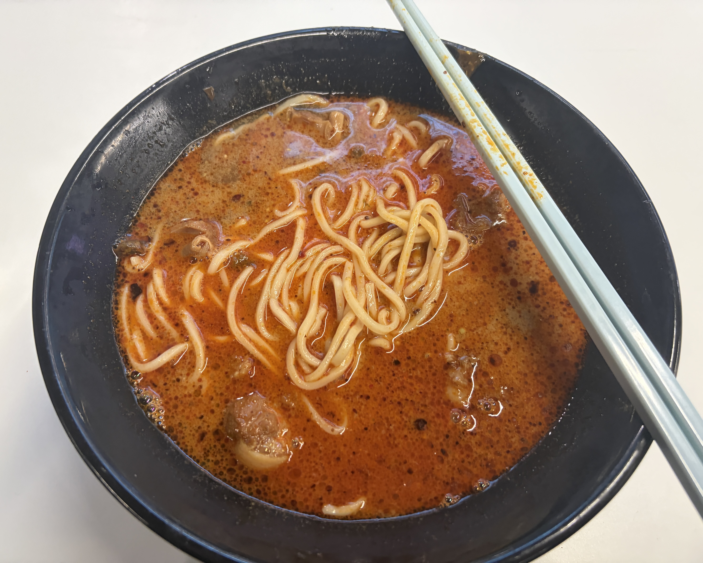

韩式肥牛拌饭 8/10 日韩窗口

还不错的一顿饭，看起来份量有点少但其实还可以。

下面有很多的豆芽包菜之类，配上紫米饭，虽然感觉不出来哪里韩式但体验还是不错的。

韩式炸鸡 6/10 日韩窗口

太久之前吃的了，回忆不起来了，以后再补qwq

upd：再吃了一次，感觉炸鸡的脆壳又厚又硬，味道只在上面淋的酱，里面的肉又少又没啥味道，给到一个NPC

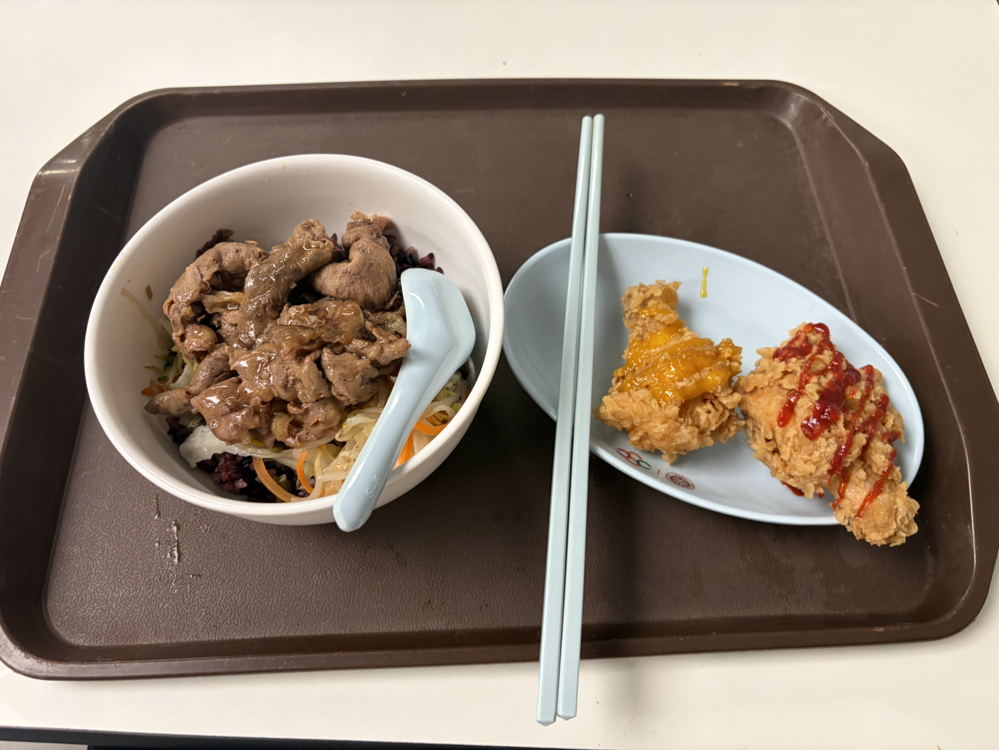
{width=400}

辛拉面 6/10 日韩窗口

这拉面真是没什么肉啊，然后对我来说好像又太辣了，好像就纯在吃辣味

看起来很便宜卖相也不错，但其实相当一般TAT

寿司 6/10 $\to$ 4/10 日韩窗口

可能是和拉面一起吃的缘故，感觉碳水爆炸了，这个寿司更是全是碳水

下次单独享用一下

upd：又吃了一次，这个寿司也太难吃了。看起来芝士烤寿司很香，实则芝士搭配下面一大坨米饭巨腻，然后那个芝士酱又巨咸。里面有一些金枪鱼，火腿啥的，更是加重了腻感，踩雷下次再也不吃了qwq

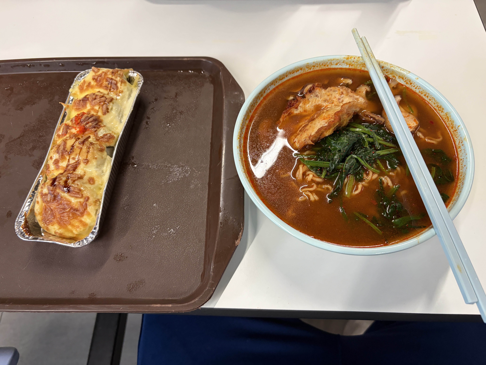
{width=400}

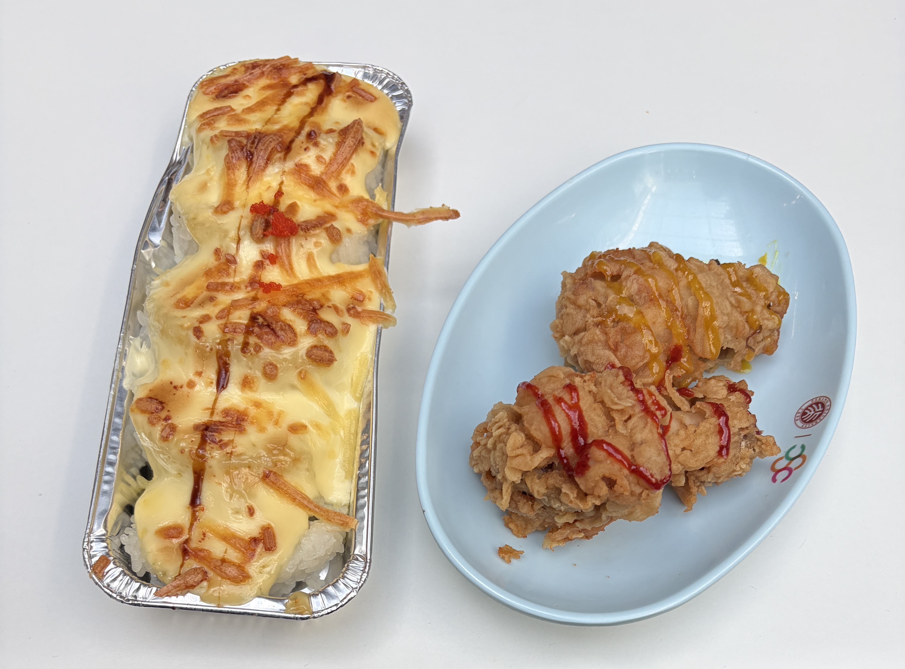
{width=400}

杭帮狮子头 9/10 江浙窗口

很大一个狮子头，一勺一勺挖起来就着饭吃简直舒服有加

香是真的香，不过也确实比较肥

这个其实最棒的是旁边的菜心和玉米，堪称点睛之笔，可以解腻，同时吸收溢出的酱汁

总之夯爆了

upd：被老吃家瑞平太腻了，这可能与本人的不良高脂饮食习惯有关qwq

{width=400}

叉烧滑蛋饭 12元 9.5/10 广东窗口 

直接给到一个夯爆了，吃过的最美味的滑蛋，搭配不会很肥也不会纯瘦的叉烧，超级下饭

但如果只有这样是不足以给到夯爆这个等级的，这个广东窗口最棒的就是给的这两个青菜，貌似经过了一些调味，出餐的时候青菜的温度更是刚刚好，我最讨厌吃到热气腾腾的青菜。这使得这两份青菜超级爽口，起到一个完美的解腻效果。

upd：被老吃家瑞平叉烧太少了，但我确实比较重点享受滑蛋部分，叉烧的量对我来说应该是刚刚好的awa

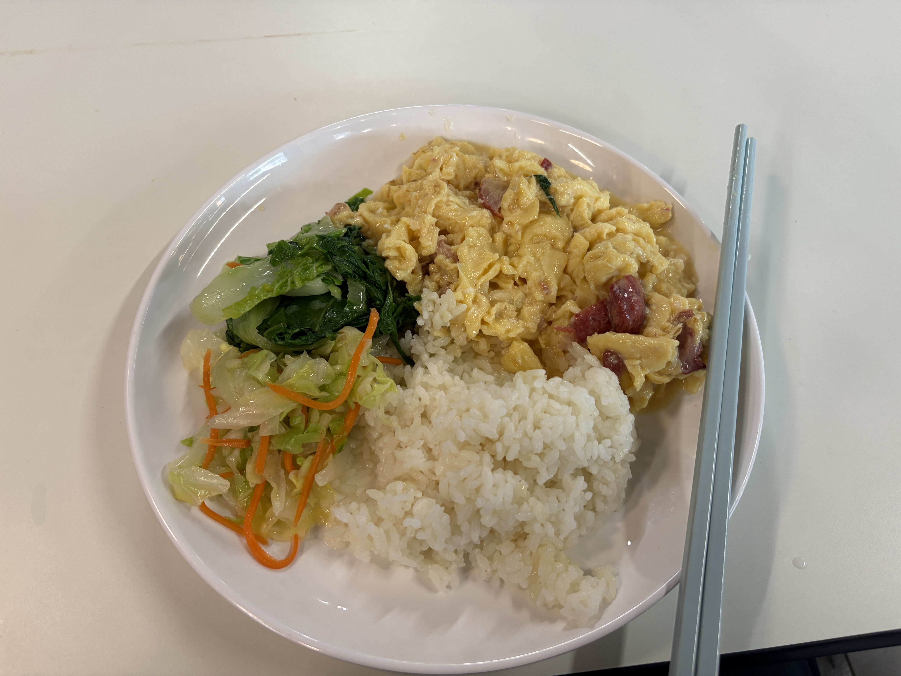

茄汁猪扒饭 7/10 广东窗口

同样是广东窗口出品，这个炸猪扒就显得非常平平无奇，脆皮不是脆皮，软绵绵，然后看一眼就想象得出内馅的味道吧。。

只能说不是专门做这些猪扒牛扒啥的店绝对整不出好吃的扒的，给到一个能吃的评价

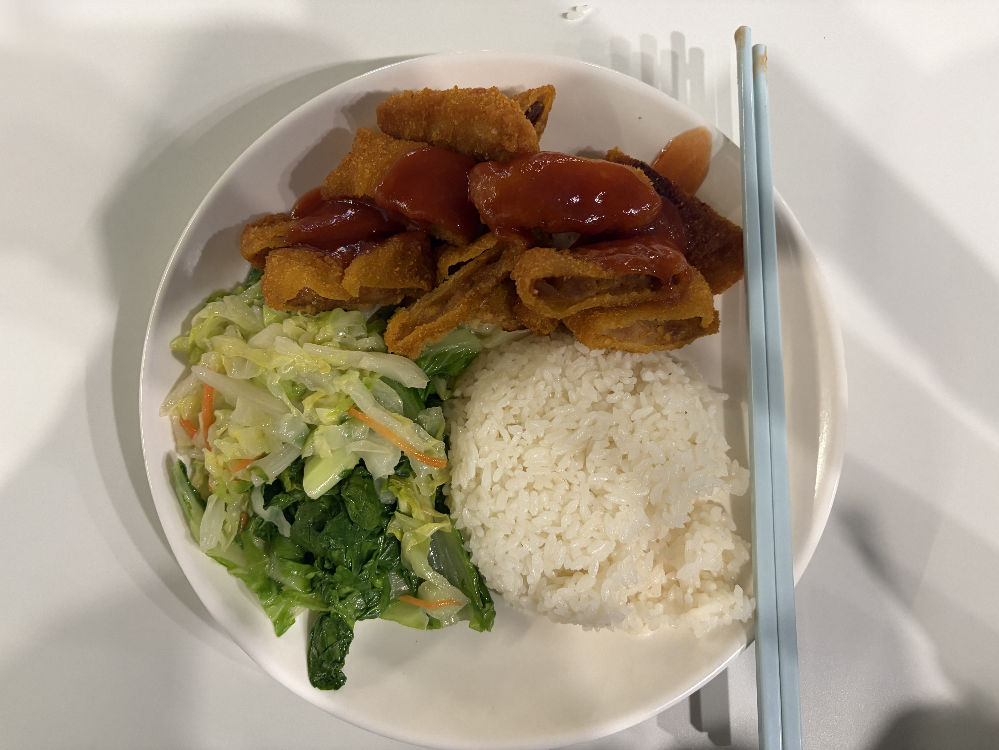

卤肉饭（存疑？） 8/10 闽南窗口 

可以认为是三楼把子肉饭的tour版，优点当然是旁边有非常爽口的蔬菜解腻，这个蔬菜每次都必须表扬一下啊！

肥瘦比例也还可以，香的很啊。不习惯吃肥肉的肯定会觉得比较腻，请慎重awa

.jpg)

云吞面 7/10 广东窗口

原来云吞面是这样的吗。这个面韧性好强啊，然后又特别细，感觉在啃塑料（？）

云吞还行，比较好的是这个汤，咸味很淡，到最后来上几口汤，相当舒服

.jpg)

烤冷面 7/10 轻烹饪窗口

怎么好像完全没肉啊。这个可能适合再去旁边的窗口加个肉？

烤的挺不错的，上面甜辣的酱料是主要的风味。但我好像实在不懂烤冷面，可能大家还是自己评判吧。

 1.jpg>)

渣渣牛肉饭 7/10 闽南窗口

家三好像也有这个渣渣牛肉饭。对比下来，二楼的这个明显辣度高出一个层级，辣到我吃到一半得去洗把脸缓一下uwu

真能吃辣的bro可以尝试一下，风味还是很不错的，鉴于我被辣通透了只能给7分了

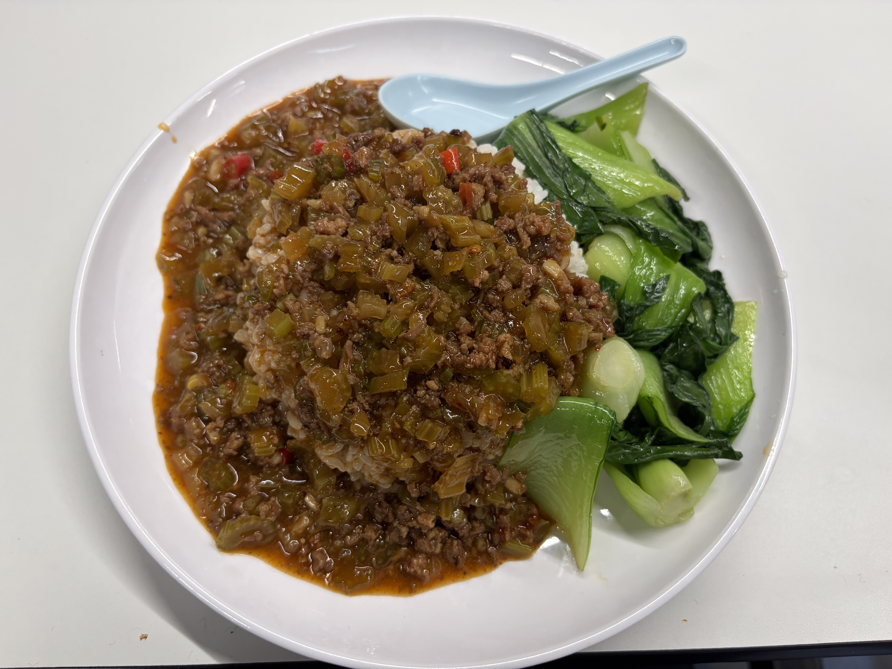

# 家三
#### 正餐

香辣鸡腿饭 7元 评分6.5/10

没感觉出香辣在哪。。鸡腿炸得还不错，可惜没啥味道，非常朴素毫无特点的一顿饭

醪糟汤圆 3元 评分8/10

感觉像发酵的味道，有一点点米酒味。黏糊糊的，作为饭后甜点很不错，但是分量太大了qwq

口味比较单调，要是分量腰斩就差不多了

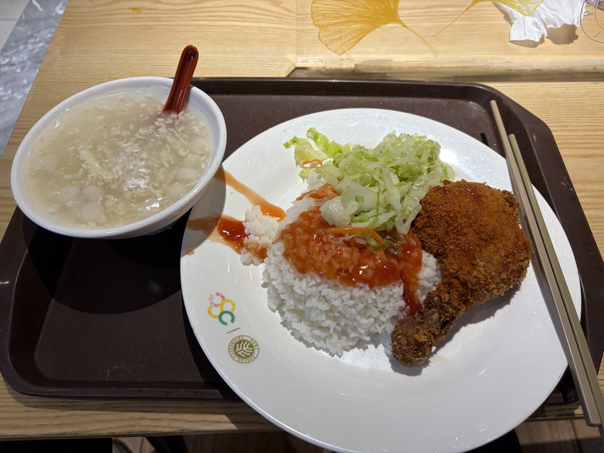
{width=400}

鲜虾肠粉 7/10

作为广东人其实吃过的肠粉很少 ;w; 所以只依赖我当时的味觉感受来评价

肠粉整体的风味是不错的，酱油的味道也和肠粉本身搭配的很不错

但是感觉只有几个虾仁作为肉的话，碳水占比太高了，一口吃进去全是碳水...

下次有机会试一下这个窗口的别的肠粉对比评价以下qwq

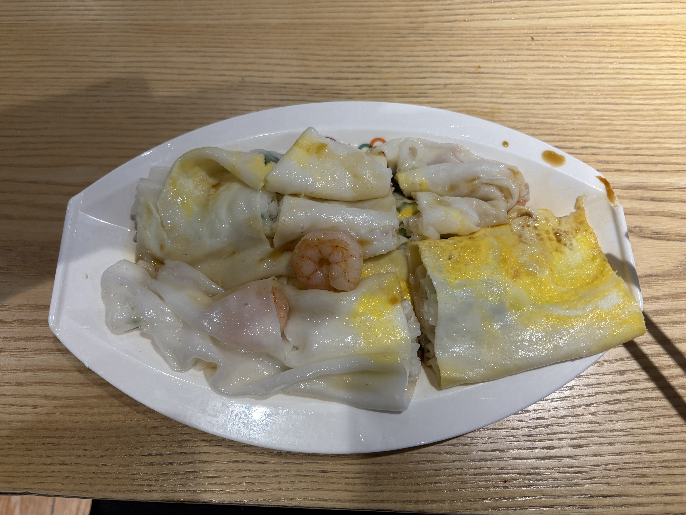

云吞 7/10

普普通通。和水饺一样不突出也没啥好吐槽的！

.jpg)

豌杂面 7/10

怎么感觉不如遇见小面？

感觉豌杂面的通病就是，很难把面和肉末、豌豆啥的捞均匀，导致前期一直在嗦白面，最后剩下一大摊肉酱之类的，直接吃会比较咸。。

好像就给了两条青菜，还是热乎乎的，老的不行，只能给到人上人了

.jpg)

锡纸烤鱼 3/10

这个真给我吃到面露难色了，你可以在一块任意小的鱼肉中找到鱼刺（鱼刺域的稠密性）。最难受的其实还是整个烤鱼不是热的，可以说是微温接近常温，那你作为一个锡纸烤鱼的优势是什么呢？

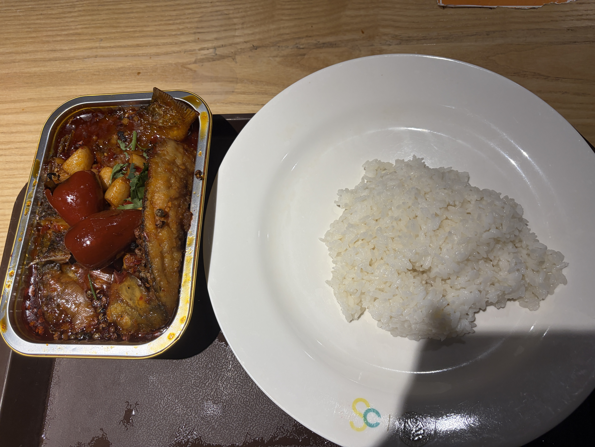

# 家四
#### 正餐

{width=400}

美式肋排 8/10 

肉酱意面 8.5/10

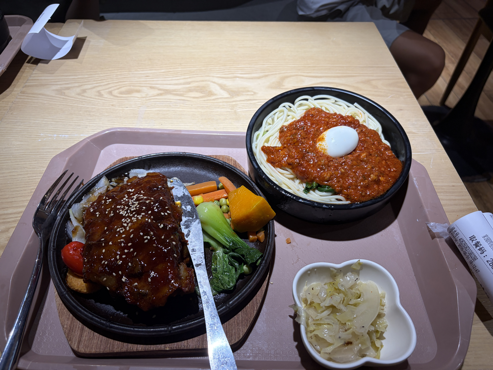
{width=400}

# 农一
#### 正餐
麻酱肥牛冷面 12元 评分6/10

面是粗面，肥牛量也很够，但是我对冷食的感觉一般。而且对我而言，冷面和麻酱契合度很低。

加了很多豆芽青瓜啥的，配料比较丰富。吃起来不会腻，很大程度上是这些配料的功劳

好处是排队人比较少。比较快就可以吃上一顿相对比较满足的餐食

猪肉三鲜水饺 7.5元（大份） 9/10

水饺不多评价，只要带肉馅都可以给到夯，最棒的是还不用排队awa

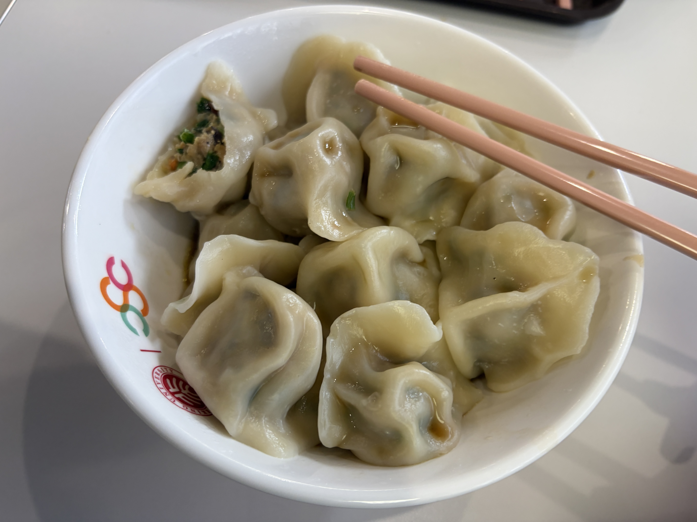

韭菜鸡蛋水饺 7.5元（大份） 8/10

水饺应该怎么吃都不太会踩雷的吧，虽然说是全素的，但是吃的也很满足，何况这么一大碗只要七块五..

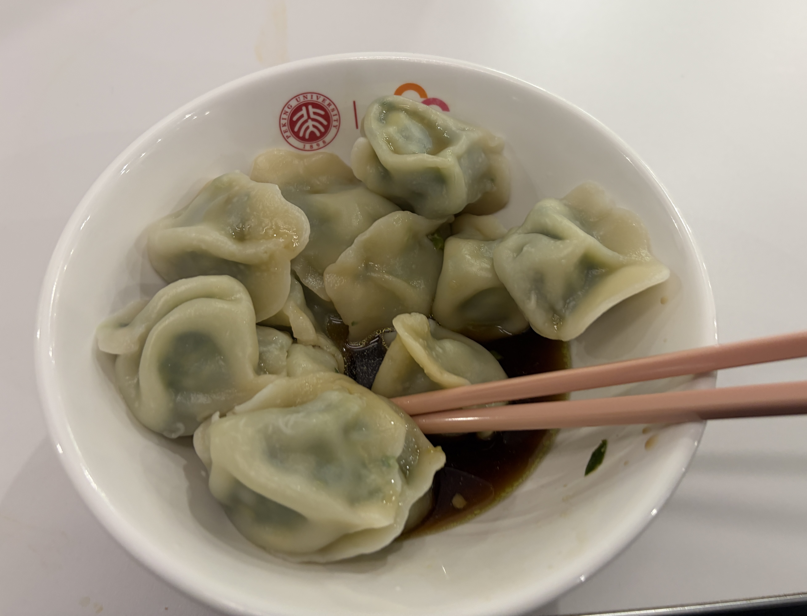

扬州炒饭 6.5/10 南京美食节

没什么特色的炒饭，配料也就那样，味道也就那样，也许应该说这样的炒饭就不适合单吃作为一顿午饭？

旁边两个神秘糕点 4/10 南京美食节

这到底是啥玩意，干巴巴的，那个撒满芝麻的好像是咸口的，但感觉非常噎；白色的里面好像是豆沙还是啥的，依旧非常干 ，好奇怪;w;

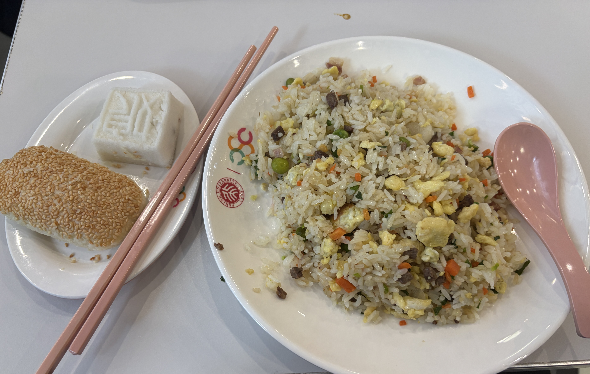
# 农二

手抓饭 7/10

羊肉串 8.5/10

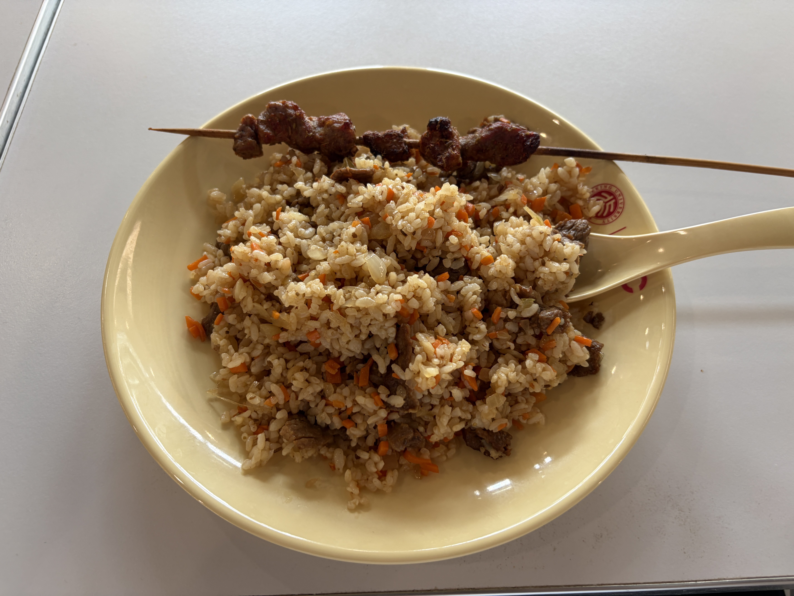
{width=400}

番茄肥牛木桶饭 8.5/10

震撼美味！怪不得这个窗口这么多人排队，番茄肥牛分量十分给力，肥牛本身的肉香和番茄的酸甜口相得益彰。

其实我是番茄炒蛋死忠粉， 尤其是这种新鲜现做的，本来就美味的鸡蛋加上香喷喷的肥牛，爽翻了~

但是没有青菜。该说是缺点还是优点呢yiw

.jpg)

广式腊肠滑蛋饭 8/10

口感算是非常丰富，尽管其中有一些我不太爱的食材稍微干扰了风味~

不过滑蛋这个名称是有点不太恰当了，最多只能算腊肠炒蛋饭。

腊肠分量也是很不错的，不过虽然是广式腊肠，这顿饭的整体口味和广式又不太搭边呢。没关系，好吃就行。

.jpg)

脆皮鸡拌饭 6/10

可以看到有致死量的“脆皮鸡”，但是和看起来一样，比较干巴，嚼多了就很吃力

下面看起来都是饭，实际上却有非常丰富的配菜，比如小瓜，茄子，之类之类的。（不记得了）要是整碗饭都吃完感觉非常的撑，而且超多肉很容易腻。只能给到一个npc了。

.jpg)

# 燕南
#### 正餐
滑蛋炸猪扒饭 16元 评分7.5/10

滑蛋终于是滑蛋了，很有感觉

缺点是猪排比较朴素，不是那种很厚实的，不过这个价位也不错了

期待加点那种搭配猪排的酱汁，味道能更上一层楼

槽点不多，值得推荐

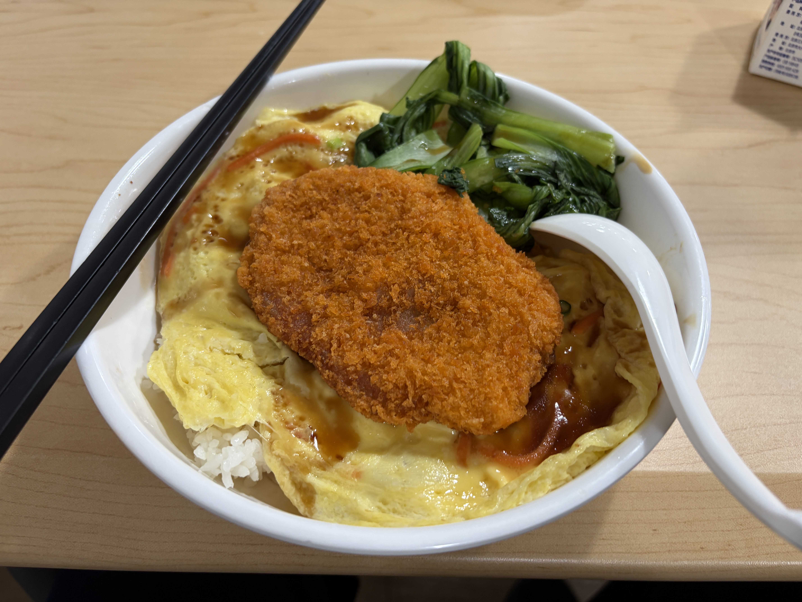
{width=400}

虾仁滑蛋饭 8/10

评价类似上条，虾仁稍微有点少，总体还是挺不错的

章鱼小丸子 7/10

朴素的小吃，但是这怎么有点凉了啊。饭堂老喜欢把饭打出来放旁边晾着，不一会就凉了，我每次看到阿姨/大叔拿这种晾一边的给我都面露难色，只能抽奖希望拿到的还没凉。

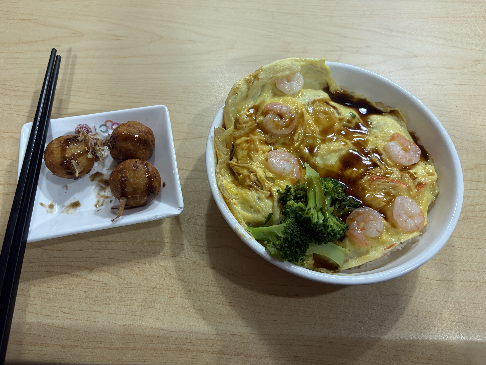

咖喱猪扒饭 8/10

我估摸着这个猪扒和上面的猪扒滑蛋饭是同一个猪扒啊，相当一般！

但是这个咖喱其实相当值得称赞，土豆切的大小也刚刚好，不像广州某二中的，还要我自己咬开再去蘸咖喱

咖喱风味非常不错，猪扒换成优质的猪扒就可以媲美外面的咖喱猪扒饭了，不过确实没有这个条件。

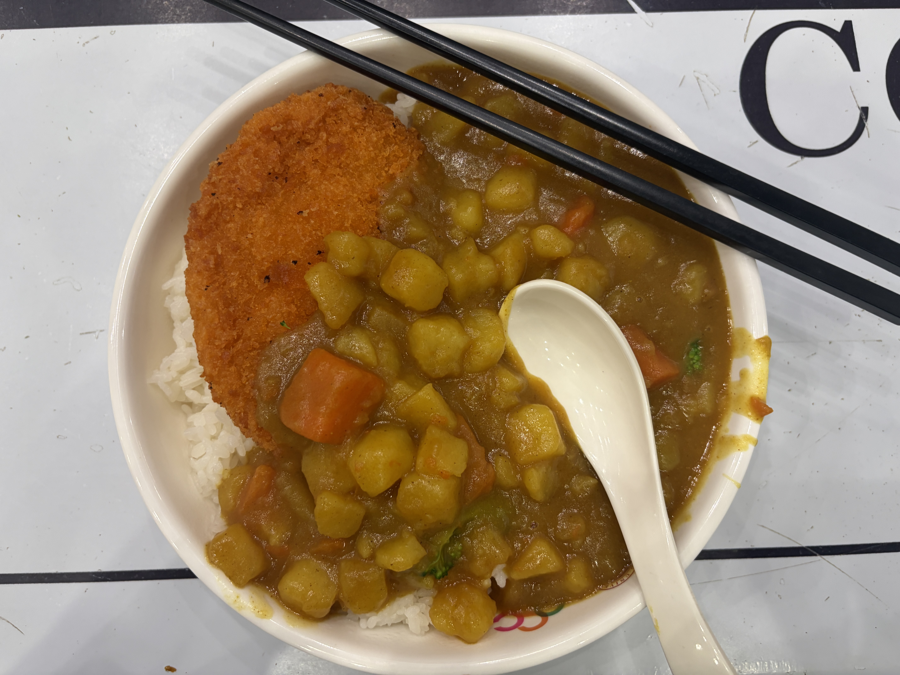

烧鹅 8/10

鹅肉还不错，皮嚼起来就很有正宗烧鹅风味。配的蔬菜不如家二那么好，以及还有酸豆角，根据某正统广东人的批评，广东人吃烧鹅不会加这个的吧？owo

以及我比较中意酸梅酱uwu希望以后会有酸梅酱供应

鸡汤抄手 8.5/10

葱花是自己撒的，抄手不多评价，平淡而美味（抄手和云吞的区别是什么？）

可以夸奖一下这个汤，吃完抄手来一大口，感觉暖洋洋的，充分享受到鸡汤的鲜美

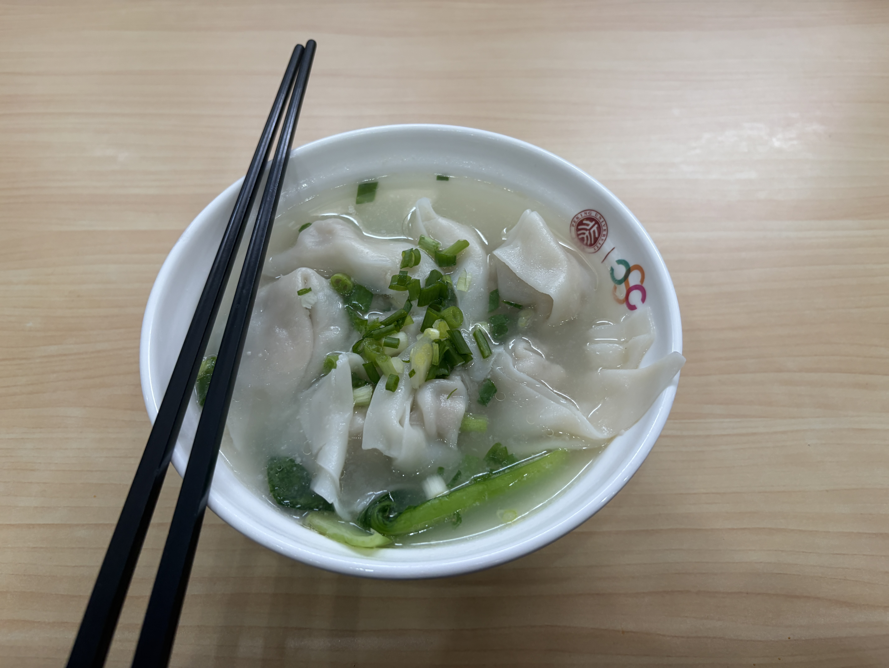

照烧鸡腿肉？  5.5/10

感觉我在吃预制的二中奥尔良鸡扒，常吃二中散打窗口的多多少少都吃过那个鸡扒，腌料的味道相当重，肉质也是一言难尽

黄金糕 7.5/10

好像和我在广东吃的不一样啊，作为一个黄金糕爱好者，我应该可以自信的说出这个黄金糕的不足之处：内部太干太紧实了，对的黄金糕应该是松软的，里面还有点湿润的。

但是能在广东之外的地方吃到这个，还是给一点情怀分吧0u0

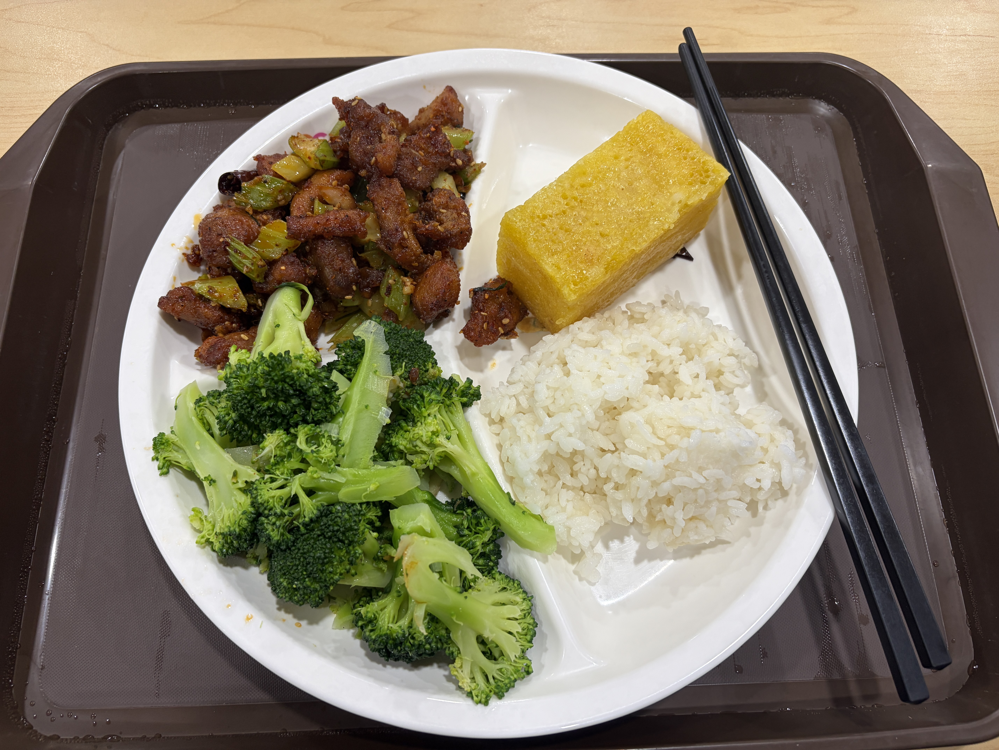

# 畅春

# 艺一

# 艺二

# 勺中

# 勺西

# 佟园
