# 学一
#### 早餐
#### 正餐
涮羊肉 大份20元 评分8.5/10

我加的是麻酱，羊肉分量非常够，吃起来很过瘾

不过热量高当然是真的，过瘾是过瘾了，就是要胖了qwq

粉丝量有点不够，要是换一些青菜变成粉丝就更好了

吃的居然有点饱，可能和当天状态有关qwq

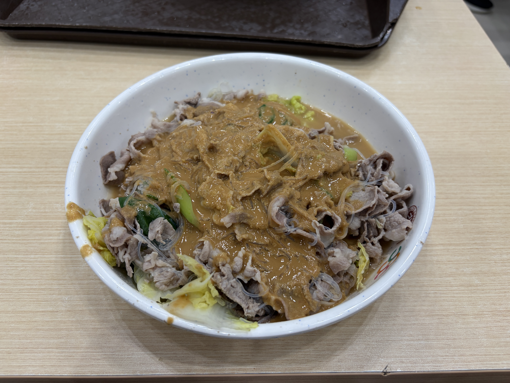
{width=400}

# 学五
#### 早餐
#### 正餐
黑椒肥牛滑蛋饭 18元 评分6/10

洋葱加的实在是太多了，以至于黑椒和洋葱冲击般的味道占据了绝对上风

牛肉品质一般般，有一些嚼不动的筋啥的

滑蛋也不像一般的滑蛋。总之问题就在香味被黑椒和洋葱掩盖了。

分量还是不错的

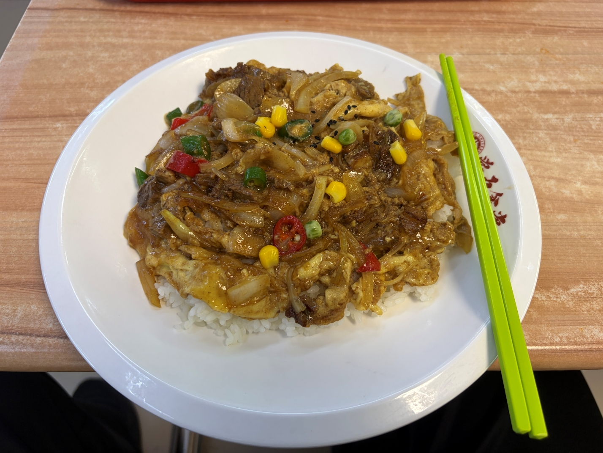
{width=400}

黄金鸡柳饭 5.5/10

鸡柳软绵绵，没啥味道，这顿只能说能饱腹，好像回到了小学那超级难吃的饭堂。。

好吧其实是我蔬菜选错了，冬瓜盖在饭上让饭变得湿漉漉的，体验进一步下降

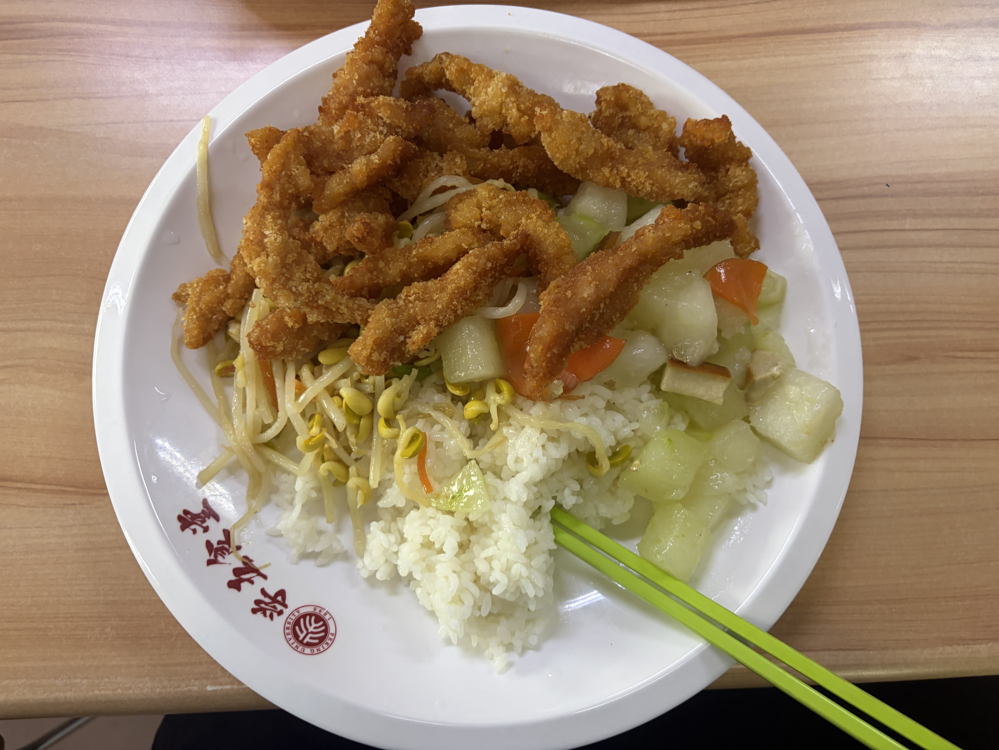

# 家一
#### 早餐
韭菜饺 评分3/10

没肉吗？这咋吃

皮还是硬的，根本没加热透

拉完了

虾饺 评分 5/10

像在嚼大团有韧性的面团，总而言之虾太少了，面皮太厚了

煎堆 评分7/10

个头加大版的煎堆，比较油腻

普普通通，也没什么槽点

# 家二
#### 正餐
烤五花肉拌饭 16元 7.5/10

五花肉味道不错，还有紫菜丰富口感

但是我很讨厌泡菜，以及里面加的一些黄色姜块。

要是换点别的配料就完美了

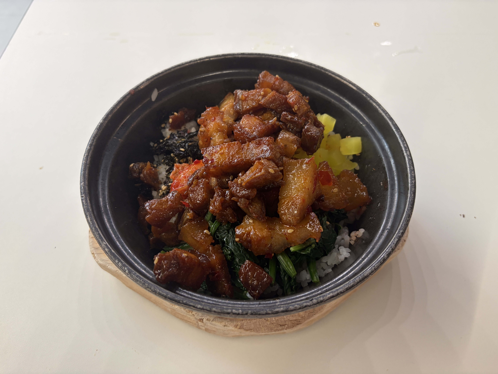
{width=400}

重庆牛肉小面 16元 9/10

感觉回到了成都的那个难忘的小面馆！当然辣度完全比不上，但对于广东人的我来说刚刚好XD

牛肉的质量其实有点不稳定，根据我吃这道菜的多次经验...但是总体来讲还是很好的，给我留下了很不错的印象

分量对我刚刚好

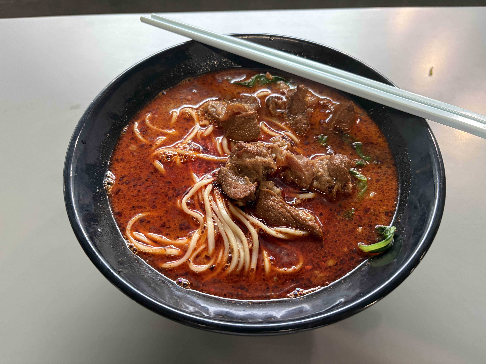
{width=400}

重庆排骨小面 16元 8.5/10

肉比牛肉面少一点，不过胜在没有那种嚼不断的筋啥的，可能这就是排骨的独有优点！

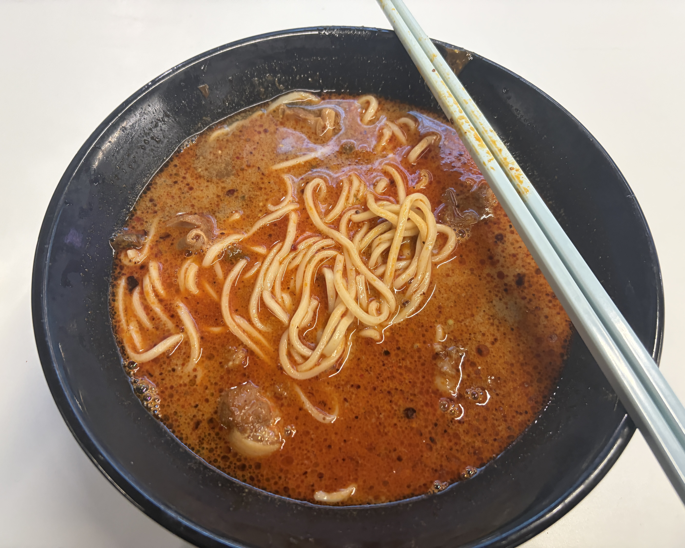

韩式肥牛拌饭 8/10

还不错的一顿饭，看起来份量有点少但其实还可以。

下面有很多的豆芽包菜之类，配上紫米饭，虽然感觉不出来哪里韩式但体验还是不错的。

韩式炸鸡 6/10

太久之前吃的了，回忆不起来了，以后再补qwq

upd：再吃了一次，感觉炸鸡的脆壳又厚又硬，味道只在上面淋的酱，里面的肉又少又没啥味道，给到一个NPC

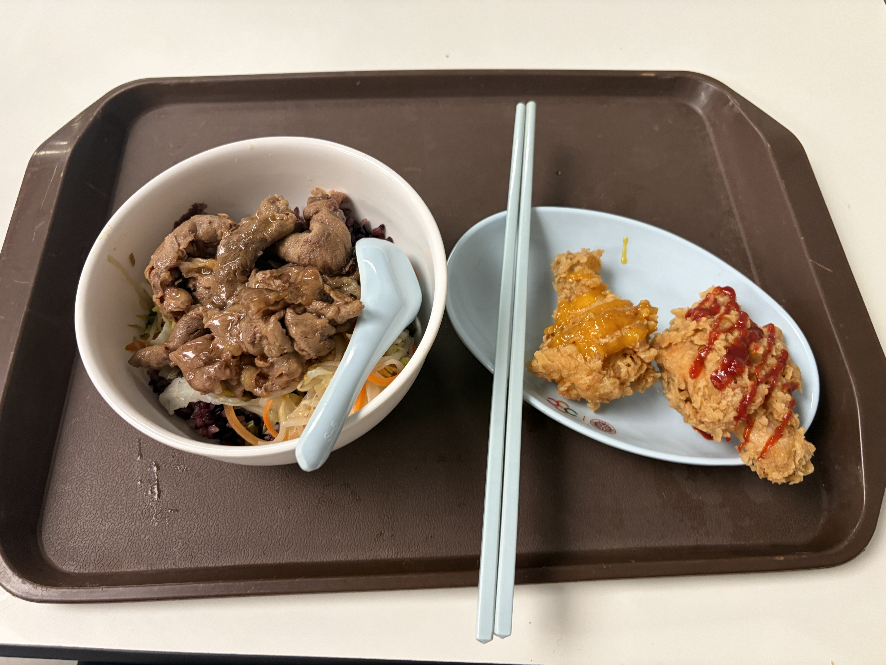
{width=400}

辛拉面 6/10

这拉面真是没什么肉啊，然后对我来说好像又太辣了，好像就纯在吃辣味

看起来很便宜卖相也不错，但其实相当一般TAT

寿司 6/10 $\to$ 4/10

可能是和拉面一起吃的缘故，感觉碳水爆炸了，这个寿司更是全是碳水

下次单独享用一下

upd：又吃了一次，这个寿司也太难吃了。看起来芝士烤寿司很香，实则芝士搭配下面一大坨米饭巨腻，然后那个芝士酱又巨咸。里面有一些金枪鱼，火腿啥的，更是加重了腻感，踩雷下次再也不吃了qwq

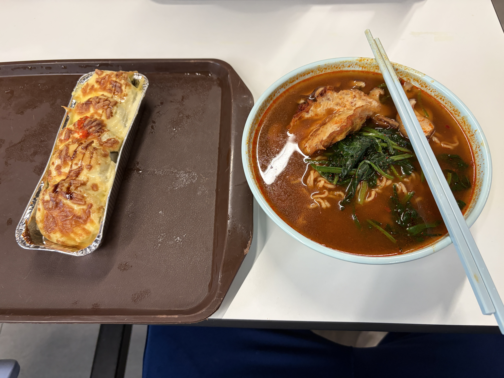
{width=400}

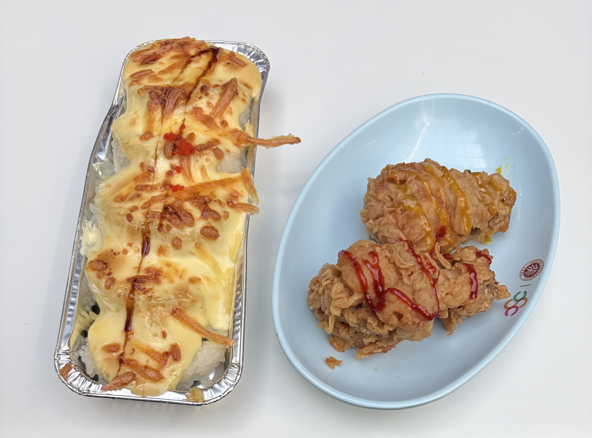
{width=400}

杭帮狮子头 9/10

很大一个狮子头，一勺一勺挖起来就着饭吃简直舒服有加

香是真的香，不过也确实比较肥

这个其实最棒的是旁边的菜心和玉米，堪称点睛之笔，可以解腻，同时吸收溢出的酱汁

总之夯爆了

{width=400}

叉烧滑蛋饭 12元 9.5/10
直接给到一个夯爆了，吃过的最美味的滑蛋，搭配不会很肥也不会纯瘦的叉烧，超级下饭

但如果只有这样是不足以给到夯爆这个等级的，这个广东窗口最棒的就是给的这两个青菜，貌似经过了一些调味，出餐的时候青菜的温度更是刚刚好，我最讨厌吃到热气腾腾的青菜。这使得这两份青菜超级爽口，起到一个完美的解腻效果。
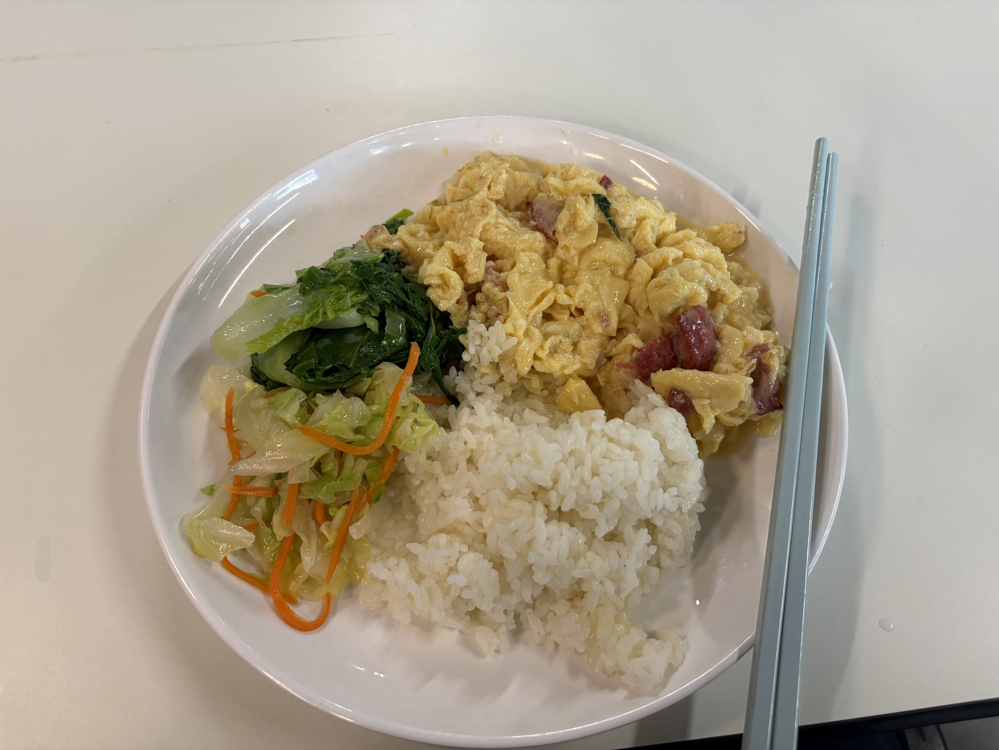

茄汁猪扒饭 7/10

同样是广东窗口出品，这个炸猪扒就显得非常平平无奇，脆皮不是脆皮，软绵绵，然后看一眼就想象得出内馅的味道吧。。

只能说不是专门做这些猪扒牛扒啥的店绝对整不出好吃的扒的，给到一个能吃的评价

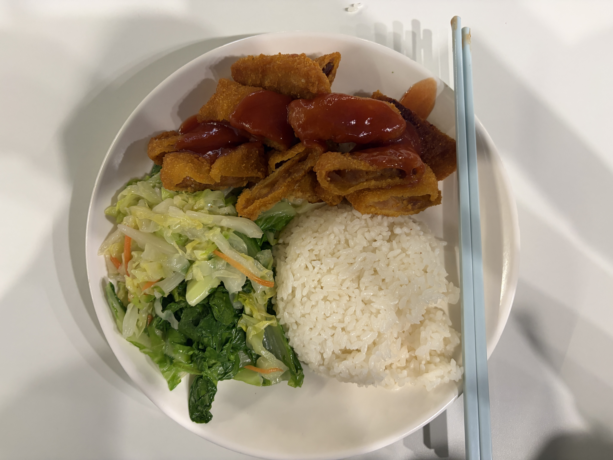
# 家三
#### 正餐

香辣鸡腿饭 7元 评分6.5/10

没感觉出香辣在哪。。鸡腿炸得还不错，可惜没啥味道，非常朴素毫无特点的一顿饭

醪糟汤圆 3元 评分8/10

感觉像发酵的味道，有一点点米酒味。黏糊糊的，作为饭后甜点很不错，但是分量太大了qwq

口味比较单调，要是分量腰斩就差不多了

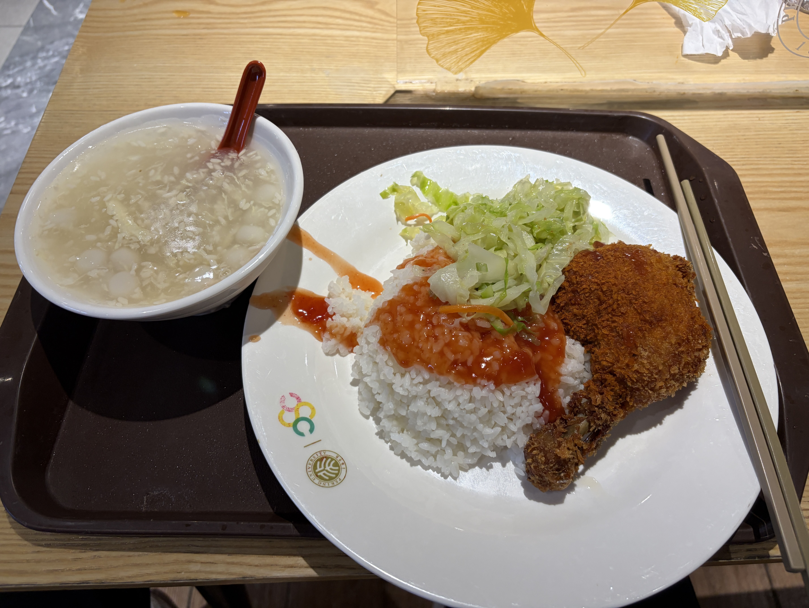
{width=400}

鲜虾肠粉 7/10

作为广东人其实吃过的肠粉很少 ;w; 所以只依赖我当时的味觉感受来评价

肠粉整体的风味是不错的，酱油的味道也和肠粉本身搭配的很不错

但是感觉只有几个虾仁作为肉的话，碳水占比太高了，一口吃进去全是碳水...

下次有机会试一下这个窗口的别的肠粉对比评价以下qwq

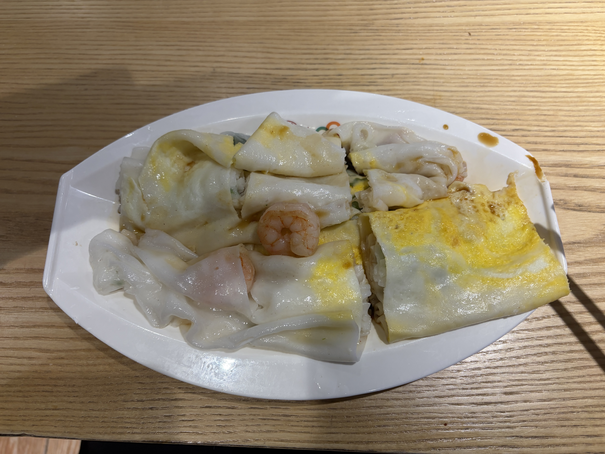

# 家四
#### 正餐

{width=400}

美式肋排 8/10 

肉酱意面 8.5/10

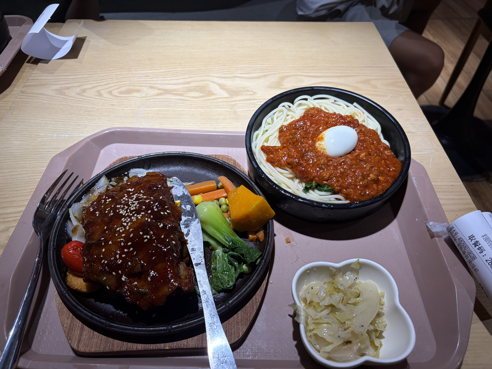
{width=400}

# 农一
#### 正餐
麻酱肥牛冷面 12元 评分6/10

面是粗面，肥牛量也很够，但是我对冷食的感觉一般。而且对我而言，冷面和麻酱契合度很低。

加了很多豆芽青瓜啥的，配料比较丰富。吃起来不会腻，很大程度上是这些配料的功劳

好处是排队人比较少。比较快就可以吃上一顿相对比较满足的餐食

猪肉三鲜水饺 7.5元（大份） 9/10

水饺不多评价，只要带肉馅都可以给到夯，最棒的是还不用排队awa

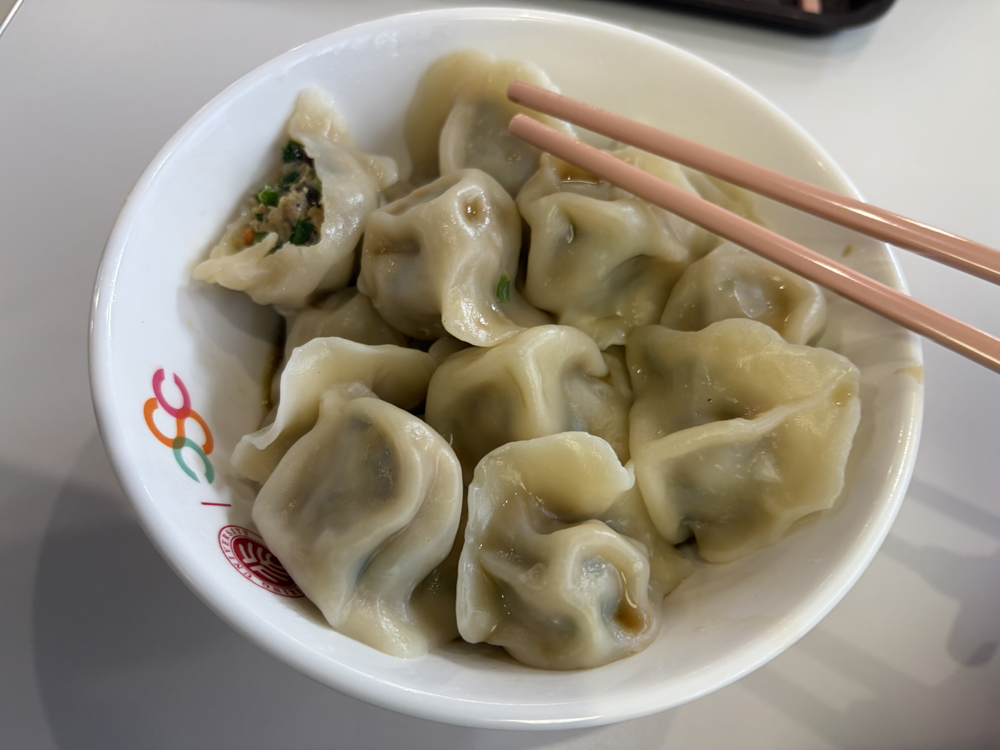

韭菜鸡蛋水饺 7.5元（大份） 8/10

水饺应该怎么吃都不太会踩雷的吧，虽然说是全素的，但是吃的也很满足，何况这么一大碗只要七块五..

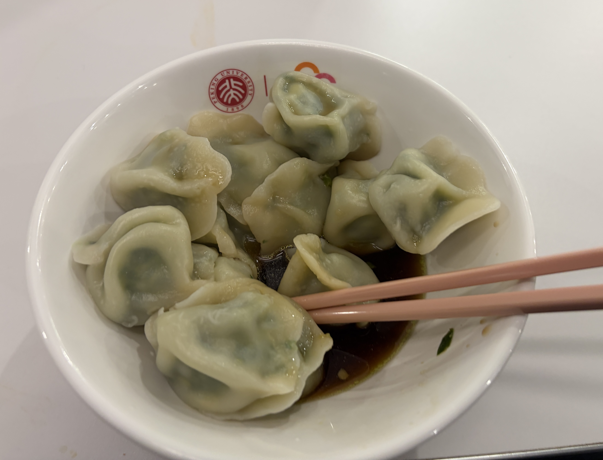
# 农二

手抓饭 7/10

羊肉串 8.5/10

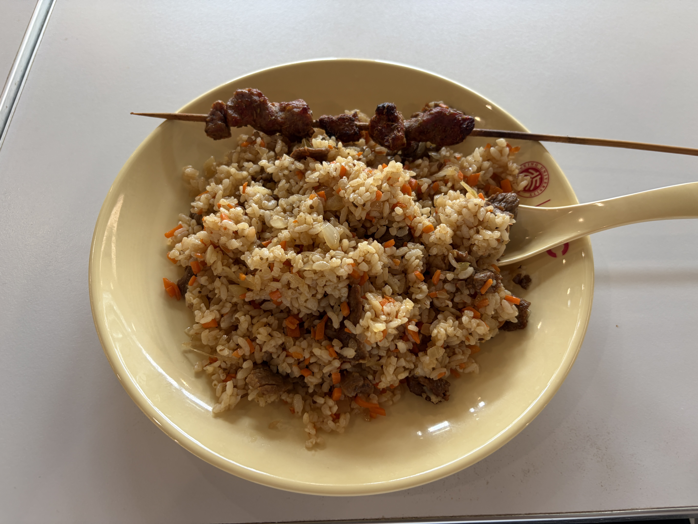
{width=400}

# 燕南
#### 正餐
滑蛋炸猪扒饭 16元 评分8/10

滑蛋终于是滑蛋了，很有感觉

缺点是猪排比较朴素，不是那种很厚实的，不过这个价位也不错了

期待加点那种搭配猪排的酱汁，味道能更上一层楼

槽点不多，值得推荐

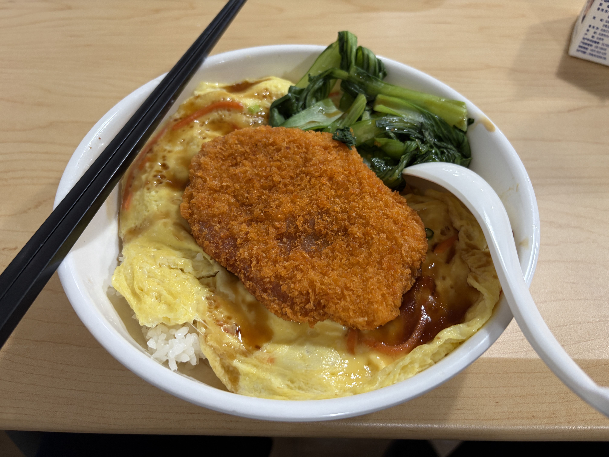
{width=400}

# 畅春

# 艺一

# 艺二

# 勺中

# 勺西

# 佟园
