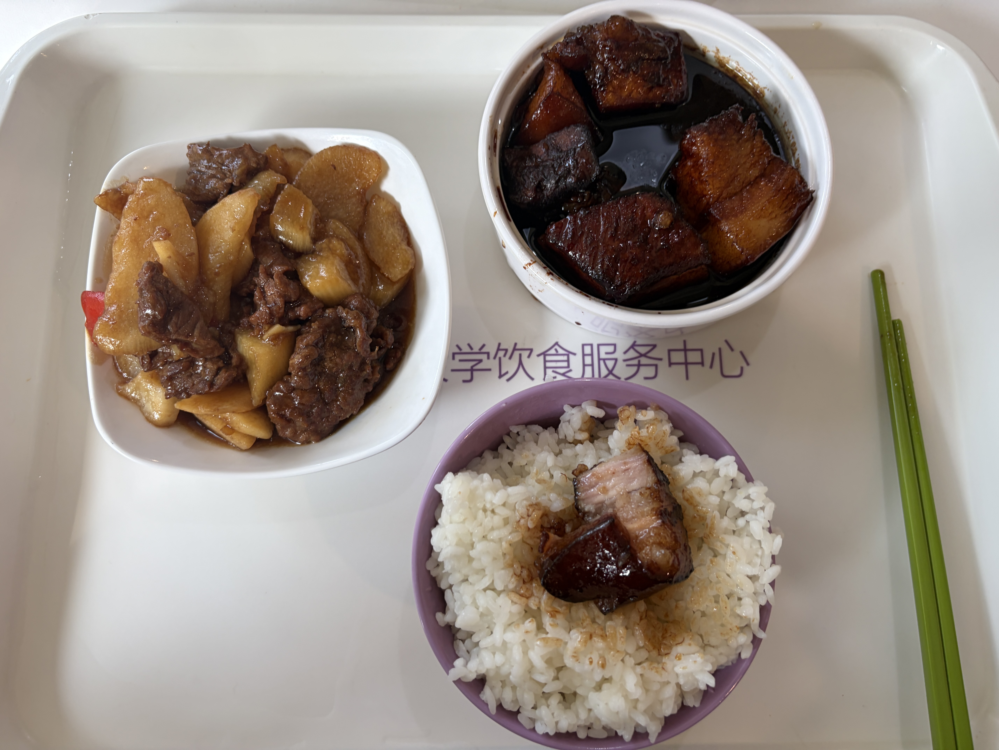
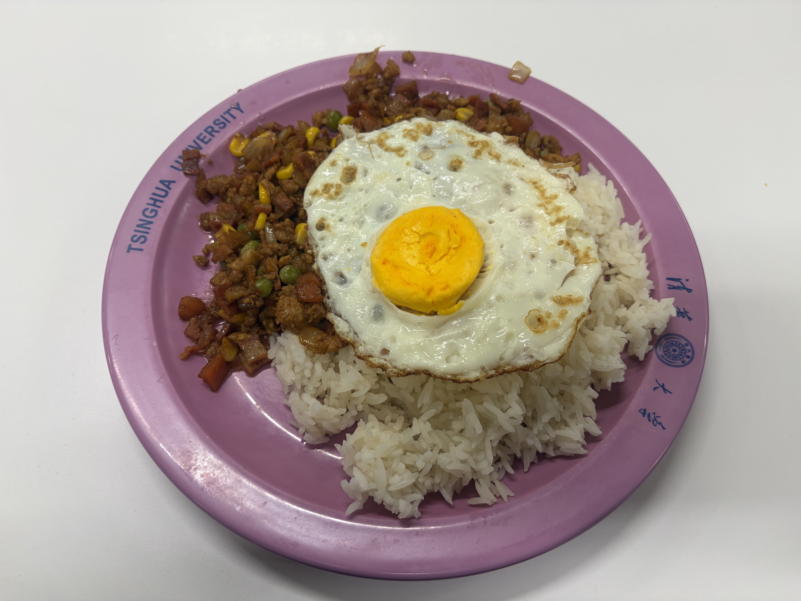
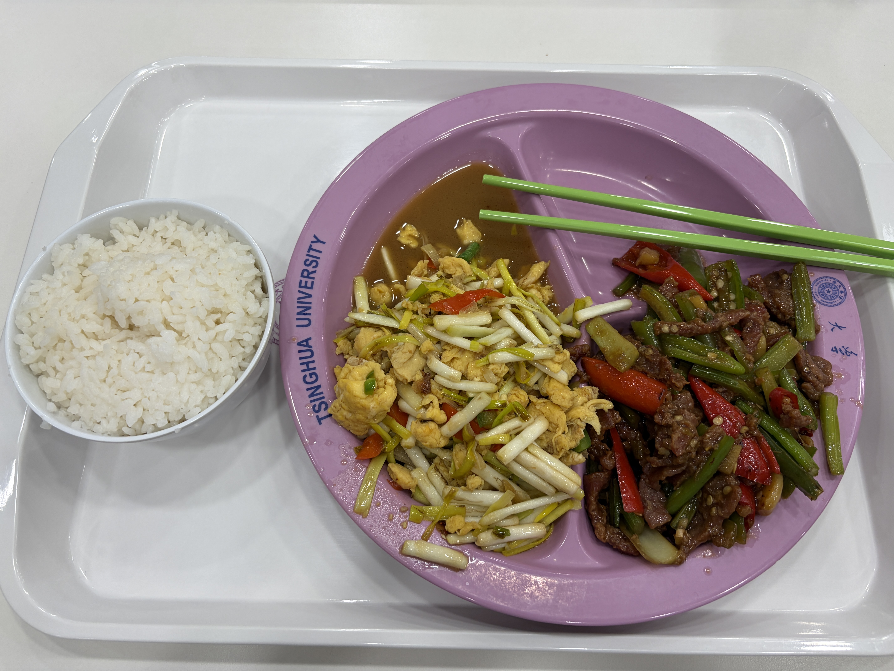

# 紫荆园

## 一楼

淮山牛肉 7.5/10

一开始以为是土豆，后来才发现是淮山。淮山口感是脆脆的，其实还挺新奇的。其他和正常的炒牛肉都差不多，也没有很咸或者很淡。

红烧肉 5/10

十分难评，我应该算口味比较重的人群，还是觉得这个菜很腻很重口。而且瘦肉部分非常的柴，肥肉又很腻很腻，吃一两块就受不了了。这一碗红烧肉貌似超级贵，口味也对不起它的价格。

## 三楼

煎蛋肉末饭？忘了叫啥了 6/10

肉末好油，吃完盘子里剩一滩油下来，然后这个煎蛋感觉煎的很差劲，黄都煎到完全粉的口感了。

米饭不知道为什么非常干巴，好像和你北的米饭差很多啊uwu

好像没有蔬菜？

# 芝兰园

辣椒蒜苔炒肉 7.5/10

炒肉是比较嫩的肉，当然也是一道下饭菜，一口肉加蒜苔配米饭扒拉下去还是十分过瘾。

不过好像还是有点偏咸。鉴于辣椒炒肉的地位还是给个7.5。

韭黄炒蛋 6/10

出乎意料的咸，韭黄和炒蛋都泡在神秘超咸酱汁中，必须有过量的米饭才能吃完这道菜。我以为韭黄炒蛋应该还算比较清淡的，但这里的怎么和我想的不太一样呢。

